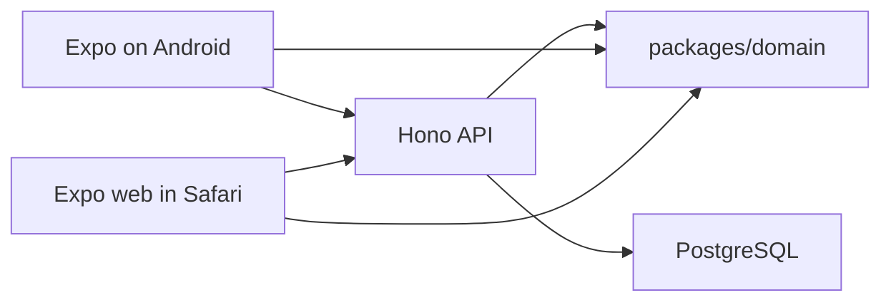

# Spendwise architecture

Status: planning baseline. 7 November 2026.

Phase 1 is a shared journal with one writer. Android and mobile Safari are two builds of the same Expo client. The money rules live in one TypeScript package that both the preview and the API call. PostgreSQL stores the journal. Balances are computed from it.

The rules themselves are in [domain-model.md](domain-model.md). Why these choices were made is in [adr/README.md](adr/README.md). What the beta must do for the group is in [product-plan.md](product-plan.md).

## Shape



The client may compute a preview locally by calling `packages/domain`. The preview is a hint. The API runs the same functions inside a database transaction and is the only writer. A preview that disagrees with a committed result is a bug in the client, not a second opinion.

## Repository

The repo will be a workspace, when code starts. This document does not create it.

```text
apps/mobile     Expo app, native and web
apps/api        Hono HTTP API
packages/domain Pure functions, no I/O
```

`packages/domain` imports nothing from React Native, the API, or the database. That limit is what makes the phone and the server run the same split.

## Stack

| Piece | Choice |
| --- | --- |
| Client | Expo, Expo Router, TypeScript. Phase 1 screens use APIs that exist on native and on web. |
| API | Hono 4 on Node LTS. One small service. |
| Money rules | `packages/domain` |
| Database | PostgreSQL. Amounts are `bigint` paise. |
| Queries | Drizzle, including the transaction around each money write. |
| Auth | Email magic link. Opaque server session. Invite-only. |
| Android delivery | An internal build. |
| iPhone delivery | The web build, opened in Safari. Add to Home Screen is documented in the trip runbook, written when the build exists. |

Native iOS can be added from the same client. It is not on the path that decides whether the trip can use Spendwise.

Nest is the wrong size for this API. Fastify is as fast as Hono on trivial Node handlers; a request that waits on Postgres does not feel that gap. Hono keeps the beta service small. Mailing provider and the host that runs the API are chosen at deploy time. They are not part of this baseline. The deploy shape is one API process and managed Postgres.

## Phase 1 operations

All of these require a session except the magic-link request and the link redemption.

| Operation | Notes |
| --- | --- |
| Request magic link | Sends one-time email. |
| Redeem magic link | Creates a session. |
| Create group | Caller becomes a member. Seeds the seven categories. |
| Read or rotate invite link | Any member. The token is unguessable. |
| Join with invite | Creates a membership. |
| List members and categories | Members only. |
| Create expense | One payer. Split mode as in the domain model. |
| Edit expense | Any member. Sends the version it read. |
| Void expense | Terminal. |
| Create settlement | One member to another, amount greater than zero, no category. |
| Void settlement | Terminal. |
| Activity | Newest first. |
| Balances and suggested transfers | Computed on read. |
| Trip summary | Total, per-member share, per-category total. Voided rows excluded. Hidden list rows still included. |

Rupee amounts cross the HTTP boundary as integer paise, or as decimal strings that the API parses with the domain parser before any arithmetic. JSON numbers with a fractional part are not a valid money input.

## Write path

A money write is one transaction.

1. Load the group and confirm the caller is a member.
2. For an edit, require the version the client read. A mismatch returns a conflict and writes nothing.
3. Reject a voided row on edit. Reject a settlement payload that includes a category.
4. Resolve the split through `packages/domain`. An exact or percentage refusal returns the gap and writes nothing.
5. Insert or update the expense or settlement and its lines. Funding lines sum to the gross. Allocation lines sum to the gross. Amounts are integers.
6. Recompute the group's balances from the live rows and assert they sum to zero.
7. Append an activity row with the actor and a snapshot of the change.
8. Commit.

A failed check rolls the transaction back. The client shows the failure. It does not keep a local copy as if the save had worked. There is no offline queue in Phase 1.

Optimistic concurrency matters on a trip: two people often fix the same dinner. The version integer is the whole mechanism. Last-write-wins is not.

## Where each invariant lives

| Invariant | Enforced |
| --- | --- |
| Split arithmetic and largest remainder | `packages/domain`, unit-tested |
| Exact and percentage totals | `packages/domain` returns a refusal; the API does not catch and repair it |
| Line sums equal the gross | API, inside the transaction, after the domain call |
| Settlement has no category | The settlement type has no category field. The API rejects a body that tries to add one. |
| Group balances sum to zero | API, inside the transaction, before commit |
| Voided rows count nowhere | Every balance and summary query filters them out. The domain tests cover the filter. |
| Only members can read or write | API, on every group route |
| Preview matches the server | The client imports the same package. It does not reimplement the split. |

A database trigger that restates the zero-sum check can wait. The transaction is the Phase 1 gate. The tests below are what stop a refactor from moving that gate.

## Authorization

- A session identifies one user.
- Group data is readable and writable by current members only.
- There is no public directory of groups.
- The invite token is the only way in. Any member can rotate it, which invalidates the previous link.
- Phase 1 does not support leaving a group. Everyone who joins stays through the trip, including in the balances.

Sessions are opaque tokens stored on the server. The native app keeps the token in the platform secure store and sends `Authorization: Bearer`. The web build uses an httpOnly, Secure cookie set by the API, and sends requests with credentials. Both hit the same routes.

## Read model

Phase 1 does not store a balance column. Balances, the suggestion, and the trip summary are queries over live expenses, lines, and settlements. A group on a trip is small enough that this stays cheap. A stored balance may be added later as a cache, rebuilt from the same rows, never as a source the writes trust more than the journal.

## Domain package surface

The names can change when the code is written. The responsibilities cannot.

- Parse a rupee string to paise, or reject it.
- Split equal, by shares, by percentage, and by exact amounts.
- Compute balances for a set of live expenses and settlements.
- Suggest transfers from those balances.
- Assert the zero-sum.

Inputs and outputs are plain data. Member ids are strings. Amounts are integers. Refusals are values, with the gap in paise or in percentage hundredths, not thrown strings the client has to scrape.

## Tests that gate Phase 1

These run against `packages/domain` and, for the transaction, against the API with a database.

- A dinner of ₹2000 among five people produces the balances in the domain model, and those balances sum to zero.
- Random expenses and settlements, including voids, always sum to zero. Voided rows change nothing.
- ₹100 split three ways is ₹33.34, ₹33.33, ₹33.33, stable across runs.
- An exact split that is short or over is refused, and the returned gap matches. No row is written.
- Percentages of 33.33 three times are refused. 50 and 50 are accepted and sum to the gross.
- The suggestion for a fixed balance list is stable, and its transfers sum to the debt.
- A settlement fixture has no category and does not change any member's spending.
- An edit with a stale version writes nothing.

## Client

One Expo Router app. The Phase 1 screens are: sign in, group list, group (balances and suggestion), expense list, expense form, settlement form, trip summary, activity.

The expense form collects the gross, the payer, the members, the mode, and the category, then shows the domain package's lines before the save. The confirmation copy is "You get back …" or "You owe …". The form posts paise. If the network fails, the form stays open and says the save did not happen.

Libraries for Phase 1 screens must work on web. A native-only module does not back a screen the iPhone users depend on. Receipt capture, SMS reading, and UPI intents are later, and each one has to earn a web fallback or an honest "Android only" label when it arrives.

## Data, in outline

Enough to see the journal. Column-level detail is settled when the migration is written.

- `users`
- `sessions`
- `groups`, with `currency` defaulting to `INR`
- `memberships`
- `group_invites`
- `categories`
- `expenses`, with `version`, `voided_at`, `split_mode`, `gross_paise`, `currency`
- `expense_funding_lines`, with nullable `account_id`
- `expense_allocation_lines`
- `settlements`, with `version`, `voided_at`, nullable `account_id`, no category
- `activity`

`account_id` is present and empty so Phase 2 does not rebuild the journal. There is no `accounts` table in the beta. There is no stored balance table.
